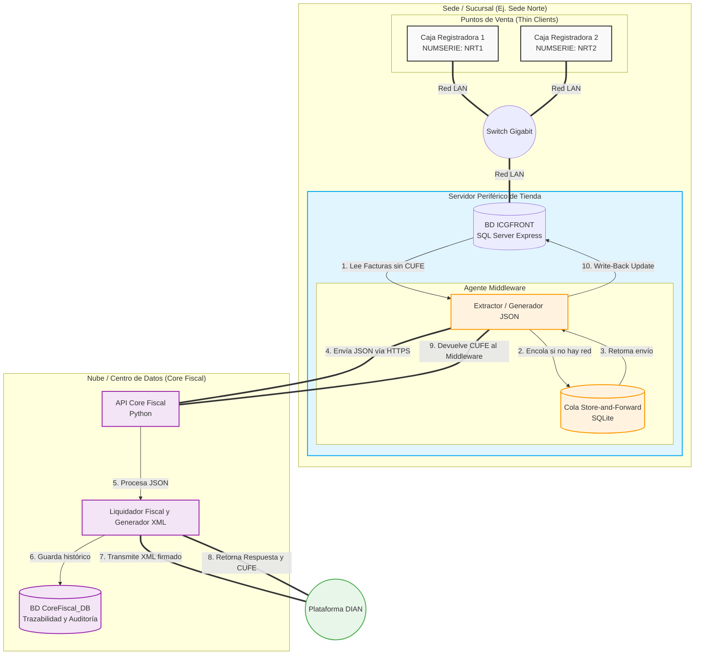

# Diagrama de Arquitectura (Edge-to-Cloud)

Este diagrama representa el flujo de datos y la distribución de componentes físicos y lógicos en la nueva arquitectura propuesta.

### Descripción del Flujo
1.  **Facturación Offline:** Las cajas (`C1`, `C2`) operan sin necesidad de internet. Guardan sus ventas directamente en `BD ICGFRONT` a través de la red LAN local.
2.  **Extracción Inyectada:** El `Middleware Local` lee continuamente la `BD ICGFRONT` buscando facturas que aún no tienen CUFE.
3.  **Contingencia Automática:** Si hay internet, el Middleware envía el `JSON` a la Nube. Si no hay internet, guarda el `JSON` en su `Cola SQLite` de forma inmutable, esperando recuperar conexión.
4.  **Cerebro Centralizado:** La `Nube (Core Fiscal)` recibe la petición, arma el XML, lo firma, se comunica con la `DIAN` y almacena la trazabilidad definitiva en su propia `BD CoreFiscal_DB`.
5.  **Cierre del Ciclo:** La Nube devuelve la respuesta al Middleware, y este hace el `UPDATE` final (Write-back) en la base de datos de ICG para que el cajero vea su factura autorizada.
